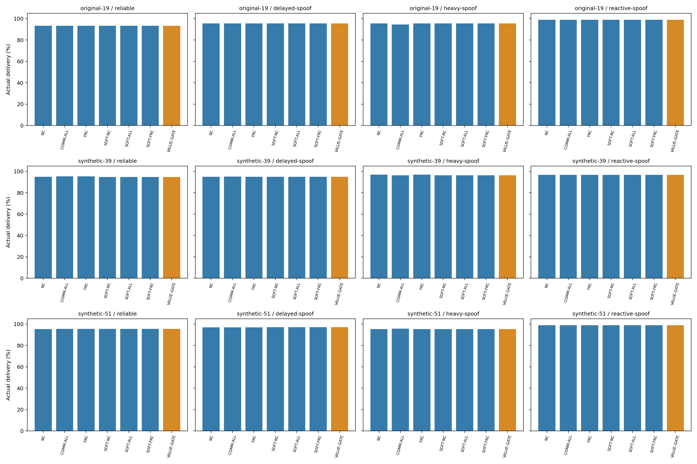
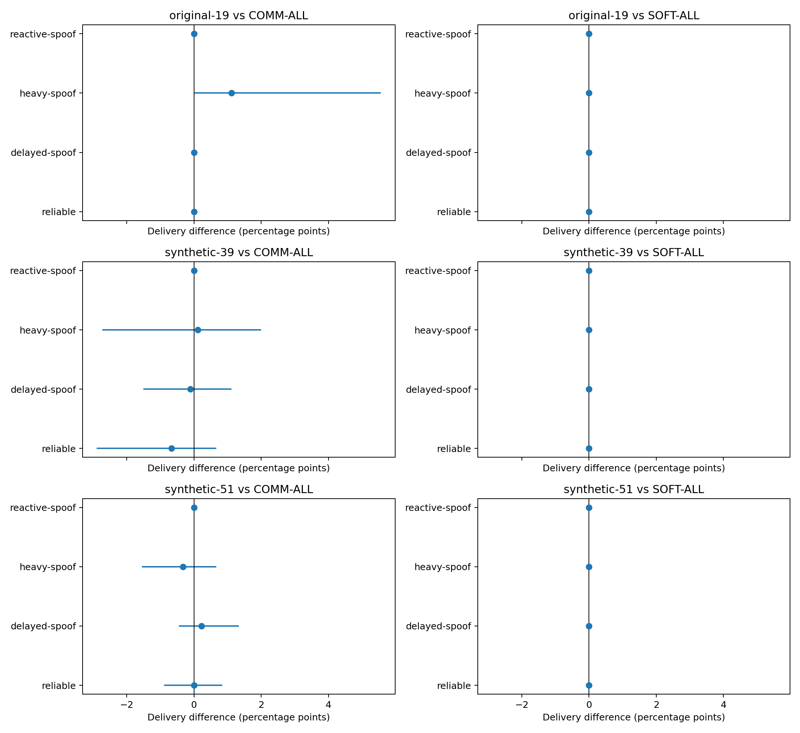
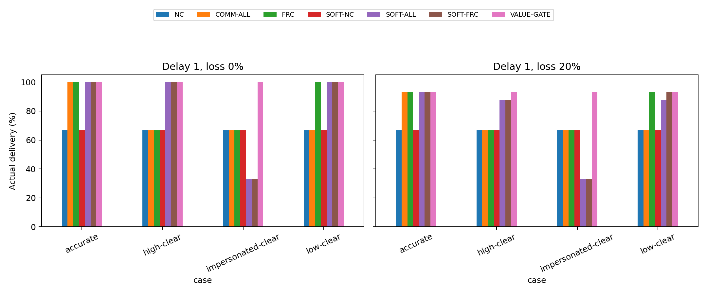
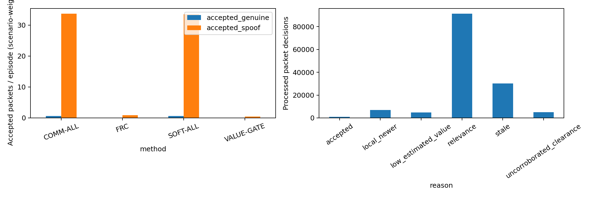
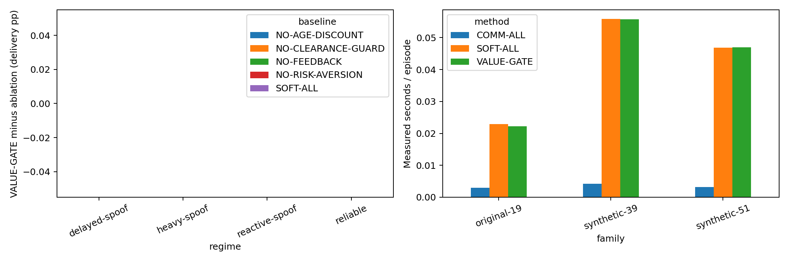
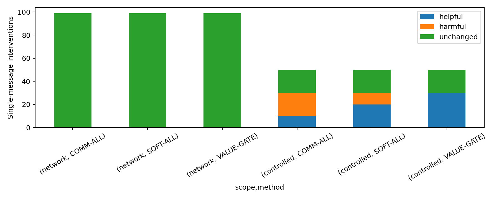
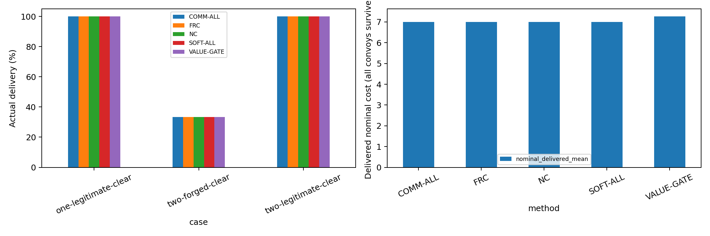
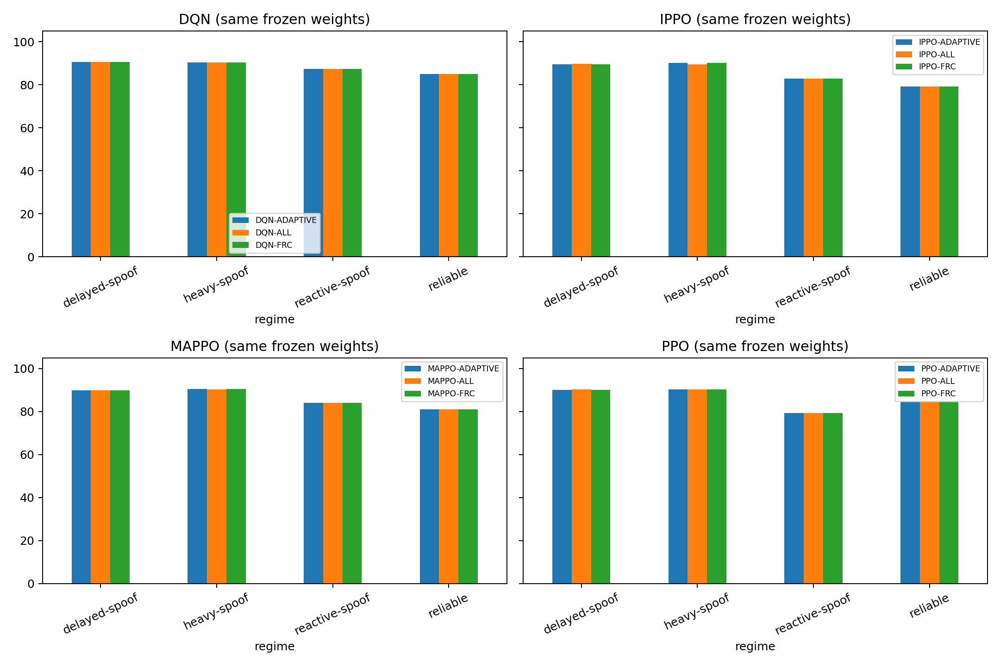

# Adaptive gate: executed results

In the constructed timely single-impersonation probe, actual delivery was 100.0% for VALUE-GATE, 66.7% for COMM-ALL, 66.7% for FRC and 33.3% for matched SOFT-ALL. Across the broader held-out study, 0 of 24 primary comparisons and 0 of 32 exploratory actor comparisons supported delivery superiority after their corrections. Legitimate clearance has a measured detour cost; two forged identities defeat the quorum. The probe demonstrates a bounded mechanism benefit, not general superiority.

An adaptive model-based gate estimates routing regret and evidence innovation, combines independent sender reports with aging, and learns local sender agreement; a conservative clearance quorum protects unverified warnings. It uses only public topology, declared sensor observations and packet contents. Probabilities and agreement scores are approximate model quantities, not calibrated confidence guarantees.

Settings were selected on separate validation episodes and three validation topologies, then frozen. Held-out graphs and episode schedules are new. Existing deep baseline models are reused with frozen weights; no new offline model training is claimed. The actor adapter preserves binary feature semantics and uses a reference-planner value proxy, not learned actor-specific message value. Soft-fusion ALL uses the same risk estimator without value filtering, so an advantage over old binary ALL alone cannot establish a gate-specific benefit. Sender identity is unauthenticated; multiple forged identities defeat the clearance quorum. Single unverified clear reports cannot erase fresh warnings or lower unknown risk in VALUE-GATE. No general superiority, convergence or operational validity is claimed.

## Verification

| status   |   heldout_episodes |   convoy_records |   processed_packets |   validation_episodes |   controlled_episodes |   network_interventions |   controlled_interventions |   superiority_supported |   primary_tests |   clearance_stress_episodes |   frozen_actor_episodes |   actor_secondary_supported |
|:---------|-------------------:|-----------------:|--------------------:|----------------------:|----------------------:|------------------------:|---------------------------:|------------------------:|----------------:|----------------------------:|------------------------:|----------------------------:|
| passed   |              35040 |           105120 |             1665227 |                  3240 |                  5600 |                     297 |                        150 |                       0 |              24 |                         750 |                    7200 |                           0 |

## Locked settings

```json
{
  "parameters": {
    "risk_aversion": 0.0,
    "age_scale": 2.0,
    "min_value": 0.02
  },
  "selection": "highest mean delivery, then shorter delivered elapsed time, then fewer accepted packets; >=5% genuine admission; deterministic parameter tie order",
  "validation_genuine_admission": 0.07079646017699115,
  "unknown_block_prior": 0.05,
  "source_hash": "4da5ccebf13143b860c2705362bb1263e1e4906c45190a4fc8260629fe405c6c"
}
```

## Primary contrasts

| family       | regime         | baseline   |   difference_pp |   simultaneous_lower_pp |   simultaneous_upper_pp | superiority_supported   |
|:-------------|:---------------|:-----------|----------------:|------------------------:|------------------------:|:------------------------|
| original-19  | reliable       | COMM-ALL   |     0           |                0        |                0        | False                   |
| original-19  | reliable       | SOFT-ALL   |     0           |                0        |                0        | False                   |
| original-19  | delayed-spoof  | COMM-ALL   |     0           |                0        |                0        | False                   |
| original-19  | delayed-spoof  | SOFT-ALL   |     0           |                0        |                0        | False                   |
| original-19  | heavy-spoof    | COMM-ALL   |     1.11111     |                0        |                5.55556  | False                   |
| original-19  | heavy-spoof    | SOFT-ALL   |     0           |                0        |                0        | False                   |
| original-19  | reactive-spoof | COMM-ALL   |     0           |                0        |                0        | False                   |
| original-19  | reactive-spoof | SOFT-ALL   |     0           |                0        |                0        | False                   |
| synthetic-39 | reliable       | COMM-ALL   |    -0.666667    |               -2.88889  |                0.666667 | False                   |
| synthetic-39 | reliable       | SOFT-ALL   |     0           |                0        |                0        | False                   |
| synthetic-39 | delayed-spoof  | COMM-ALL   |    -0.111111    |               -1.50937  |                1.11111  | False                   |
| synthetic-39 | delayed-spoof  | SOFT-ALL   |     0           |                0        |                0        | False                   |
| synthetic-39 | heavy-spoof    | COMM-ALL   |     0.111111    |               -2.7316   |                2        | False                   |
| synthetic-39 | heavy-spoof    | SOFT-ALL   |     0           |                0        |                0        | False                   |
| synthetic-39 | reactive-spoof | COMM-ALL   |     0           |                0        |                0        | False                   |
| synthetic-39 | reactive-spoof | SOFT-ALL   |     0           |                0        |                0        | False                   |
| synthetic-51 | reliable       | COMM-ALL   |     1.85037e-17 |               -0.888889 |                0.842708 | False                   |
| synthetic-51 | reliable       | SOFT-ALL   |     0           |                0        |                0        | False                   |
| synthetic-51 | delayed-spoof  | COMM-ALL   |     0.222222    |               -0.444444 |                1.33333  | False                   |
| synthetic-51 | delayed-spoof  | SOFT-ALL   |     0           |                0        |                0        | False                   |
| synthetic-51 | heavy-spoof    | COMM-ALL   |    -0.333333    |               -1.55556  |                0.666667 | False                   |
| synthetic-51 | heavy-spoof    | SOFT-ALL   |     0           |                0        |                0        | False                   |
| synthetic-51 | reactive-spoof | COMM-ALL   |     0           |                0        |                0        | False                   |
| synthetic-51 | reactive-spoof | SOFT-ALL   |     0           |                0        |                0        | False                   |

## Frozen actor contrasts (exploratory)

| algo   | regime         | baseline   |   difference_pp |   lower_pp |   upper_pp | secondary_superiority_supported   | scope                                                               |
|:-------|:---------------|:-----------|----------------:|-----------:|-----------:|:----------------------------------|:--------------------------------------------------------------------|
| dqn    | reliable       | ALL        |     0           |    0       |    0       | False                             | 32 corrected exploratory actor comparisons; fixed original topology |
| dqn    | reliable       | FRC        |     0           |    0       |    0       | False                             | 32 corrected exploratory actor comparisons; fixed original topology |
| dqn    | delayed-spoof  | ALL        |     0           |    0       |    0       | False                             | 32 corrected exploratory actor comparisons; fixed original topology |
| dqn    | delayed-spoof  | FRC        |     0           |    0       |    0       | False                             | 32 corrected exploratory actor comparisons; fixed original topology |
| dqn    | heavy-spoof    | ALL        |     0           |    0       |    0       | False                             | 32 corrected exploratory actor comparisons; fixed original topology |
| dqn    | heavy-spoof    | FRC        |     0           |    0       |    0       | False                             | 32 corrected exploratory actor comparisons; fixed original topology |
| dqn    | reactive-spoof | ALL        |     0           |    0       |    0       | False                             | 32 corrected exploratory actor comparisons; fixed original topology |
| dqn    | reactive-spoof | FRC        |     0           |    0       |    0       | False                             | 32 corrected exploratory actor comparisons; fixed original topology |
| ippo   | reliable       | ALL        |     0           |    0       |    0       | False                             | 32 corrected exploratory actor comparisons; fixed original topology |
| ippo   | reliable       | FRC        |     0           |    0       |    0       | False                             | 32 corrected exploratory actor comparisons; fixed original topology |
| ippo   | delayed-spoof  | ALL        |    -0.222222    |   -2.66667 |    0       | False                             | 32 corrected exploratory actor comparisons; fixed original topology |
| ippo   | delayed-spoof  | FRC        |     0           |    0       |    0       | False                             | 32 corrected exploratory actor comparisons; fixed original topology |
| ippo   | heavy-spoof    | ALL        |     0.666667    |    0       |    4.44444 | False                             | 32 corrected exploratory actor comparisons; fixed original topology |
| ippo   | heavy-spoof    | FRC        |     0           |    0       |    0       | False                             | 32 corrected exploratory actor comparisons; fixed original topology |
| ippo   | reactive-spoof | ALL        |     0           |    0       |    0       | False                             | 32 corrected exploratory actor comparisons; fixed original topology |
| ippo   | reactive-spoof | FRC        |     0           |    0       |    0       | False                             | 32 corrected exploratory actor comparisons; fixed original topology |
| mappo  | reliable       | ALL        |     0           |    0       |    0       | False                             | 32 corrected exploratory actor comparisons; fixed original topology |
| mappo  | reliable       | FRC        |     0           |    0       |    0       | False                             | 32 corrected exploratory actor comparisons; fixed original topology |
| mappo  | delayed-spoof  | ALL        |     3.70074e-17 |   -2.66667 |    2.66667 | False                             | 32 corrected exploratory actor comparisons; fixed original topology |
| mappo  | delayed-spoof  | FRC        |     0           |    0       |    0       | False                             | 32 corrected exploratory actor comparisons; fixed original topology |
| mappo  | heavy-spoof    | ALL        |     0.222222    |    0       |    2.66667 | False                             | 32 corrected exploratory actor comparisons; fixed original topology |
| mappo  | heavy-spoof    | FRC        |     0           |    0       |    0       | False                             | 32 corrected exploratory actor comparisons; fixed original topology |
| mappo  | reactive-spoof | ALL        |     0           |    0       |    0       | False                             | 32 corrected exploratory actor comparisons; fixed original topology |
| mappo  | reactive-spoof | FRC        |     0           |    0       |    0       | False                             | 32 corrected exploratory actor comparisons; fixed original topology |
| ppo    | reliable       | ALL        |     0           |    0       |    0       | False                             | 32 corrected exploratory actor comparisons; fixed original topology |
| ppo    | reliable       | FRC        |     0           |    0       |    0       | False                             | 32 corrected exploratory actor comparisons; fixed original topology |
| ppo    | delayed-spoof  | ALL        |    -0.222222    |   -2.66667 |    0       | False                             | 32 corrected exploratory actor comparisons; fixed original topology |
| ppo    | delayed-spoof  | FRC        |     0           |    0       |    0       | False                             | 32 corrected exploratory actor comparisons; fixed original topology |
| ppo    | heavy-spoof    | ALL        |     7.40149e-17 |   -2.66667 |    2.66667 | False                             | 32 corrected exploratory actor comparisons; fixed original topology |
| ppo    | heavy-spoof    | FRC        |     0           |    0       |    0       | False                             | 32 corrected exploratory actor comparisons; fixed original topology |
| ppo    | reactive-spoof | ALL        |     0           |    0       |    0       | False                             | 32 corrected exploratory actor comparisons; fixed original topology |
| ppo    | reactive-spoof | FRC        |     0           |    0       |    0       | False                             | 32 corrected exploratory actor comparisons; fixed original topology |

## Controlled probes: delay 1, no packet loss

| case               |   delay |   loss | method     |   delivery_rate |
|:-------------------|--------:|-------:|:-----------|----------------:|
| accurate           |       1 |      0 | COMM-ALL   |        1        |
| accurate           |       1 |      0 | FRC        |        1        |
| accurate           |       1 |      0 | NC         |        0.666667 |
| accurate           |       1 |      0 | SOFT-ALL   |        1        |
| accurate           |       1 |      0 | SOFT-FRC   |        1        |
| accurate           |       1 |      0 | SOFT-NC    |        0.666667 |
| accurate           |       1 |      0 | VALUE-GATE |        1        |
| high-clear         |       1 |      0 | COMM-ALL   |        0.666667 |
| high-clear         |       1 |      0 | FRC        |        0.666667 |
| high-clear         |       1 |      0 | NC         |        0.666667 |
| high-clear         |       1 |      0 | SOFT-ALL   |        1        |
| high-clear         |       1 |      0 | SOFT-FRC   |        1        |
| high-clear         |       1 |      0 | SOFT-NC    |        0.666667 |
| high-clear         |       1 |      0 | VALUE-GATE |        1        |
| impersonated-clear |       1 |      0 | COMM-ALL   |        0.666667 |
| impersonated-clear |       1 |      0 | FRC        |        0.666667 |
| impersonated-clear |       1 |      0 | NC         |        0.666667 |
| impersonated-clear |       1 |      0 | SOFT-ALL   |        0.333333 |
| impersonated-clear |       1 |      0 | SOFT-FRC   |        0.333333 |
| impersonated-clear |       1 |      0 | SOFT-NC    |        0.666667 |
| impersonated-clear |       1 |      0 | VALUE-GATE |        1        |
| low-clear          |       1 |      0 | COMM-ALL   |        0.666667 |
| low-clear          |       1 |      0 | FRC        |        1        |
| low-clear          |       1 |      0 | NC         |        0.666667 |
| low-clear          |       1 |      0 | SOFT-ALL   |        1        |
| low-clear          |       1 |      0 | SOFT-FRC   |        1        |
| low-clear          |       1 |      0 | SOFT-NC    |        0.666667 |
| low-clear          |       1 |      0 | VALUE-GATE |        1        |

## Fresh held-out delivery; soft comparators isolate the estimator from admission



## Bonferroni-adjusted paired bootstrap intervals for 24 prespecified contrasts



## Constructed truthful/false/impersonated reports: benefits and identity failure boundary



## Selective admission is not transmission bandwidth reduction



## Component effects and implementation overhead; measured on shared machine



## Complete packet suppression: conditional realized effects, not additive policy benefit



## Injected confirmation probes: legitimate-clear detour cost and multiple forged identities



## Adaptive admission before DQN/PPO/IPPO/MAPPO; no actor-specific value learning or retraining


