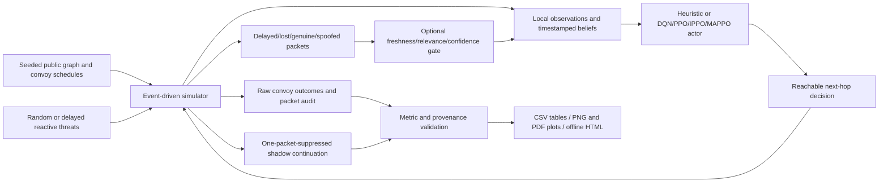

# Complete reconstructed simulation model

This is an executable synthetic research model, not a reconstruction of unprovided operational maps or proof of the submitted numerical claims. The source, fitted models, raw experiment data, audit and generated reports are delivered together. The original repository archive is preserved.



## Source map

| File | Responsibility |
|---|---|
| `simulator/ammarl2/graph.py` | Seeded topology, public costs/capacities/prior threats, reachability and Dijkstra paths. |
| `simulator/ammarl2/sim.py` | Convoy dispatch, travel, FIFO hub queues/service, threats, delayed communication, destruction and horizon censoring. |
| `simulator/ammarl2/policies.py` | Local belief processing, departure-time expiry, independently configurable filtering and heuristic hazard response. |
| `simulator/ammarl2/learn.py` | Sparse GNN actors, reachable action masks, Double DQN, shared PPO, independent convoy-slot IPPO and centralized-critic MAPPO. |
| `simulator/ammarl2/counterfactual.py` | Complete-state fork and exact suppression of one decision-processed packet. |
| `simulator/ammarl2/metrics.py` | Explicit delivery/failure counts, nominal costs, elapsed/travel/wait/service times and common-survivor pairing. |
| `simulator/run_experiments.py` | Frozen-source training/evaluation/ablation/replay commands and provenance. |
| `simulator/run_complete.py` | Complete protocol orchestration with four one-thread workers, fresh outputs and failure preservation. |
| `simulator/validate_results.py` | Source versions, optimization, schedule matching, summary/raw agreement, metric invariants and replay coverage. |
| `simulator/plot_updated_results.py` | Seven figures, vector PDFs, uncertainty intervals and machine-readable summaries. |
| `simulator/build_report.py` | Offline self-contained HTML, GitHub-readable result tables and training-window diagnostics. |
| `simulator/visualize_episode.py` | Instrumented routes/time phases for the first fixed held-out episode, checked against raw evaluation outcomes. |
| `simulator/build_bundle.py` | Complete portable ZIP with file checksums and archive verification. |
| `simulator/tests_core.py`, `simulator/tests_revision.py` | 28 executed model/learning/replay correctness tests. |

## Comparator definitions

B1 minimizes nominal cost without live information. B2 minimizes prior-threat-weighted cost without live information. B3 uses local observations with nominal weights. NC uses local observations with prior-threat weights. COMM-ALL adds peer reports to NC; GATE filters those reports. ORACLE observes current true blocks and uses an avoidance heuristic; it is a diagnostic, not a proven optimal upper bound. Each of the four learned algorithms is evaluated with none/all/gate communication and three separately trained seeds. Thus there are 19 named configurations and 43 instantiated policies per graph/episode, rather than a silently assumed nine-method list.

## Run and inspect

Install using `setup_local.sh` from the repository root, then activate `.venv`.
Run from `simulator/`:

```bash
python -m pytest -q tests_core.py tests_revision.py
python run_complete.py --episodes 300 --output out/my-run --figures ../revision/my-figures
```

To inspect delivered results, open `revision/complete-visualisations/index.html` after downloading the ZIP. GitHub renders `revision/complete-visualisations/README.md` with nine PNG figures: seven aggregate comparisons and two illustrative episode views. The seven-page comparison PDF and two-page episode PDF are in the same directory. Raw data and fitted weights are under `simulator/out/complete-model-v1/`; manifests preserve original executed absolute paths for provenance, while the documented reproduction commands use portable relative paths.

Read `simulator/METHODS.md` for the mathematical contract and `revision/complete-protocol.md` for the experiment design. Keep nominal path cost, training reward, delivery and realized survivor time distinct. Models are synthetic, partially observed baseline variants; neither a complete implementation nor longer training establishes convergence, operational validity or gate superiority.
