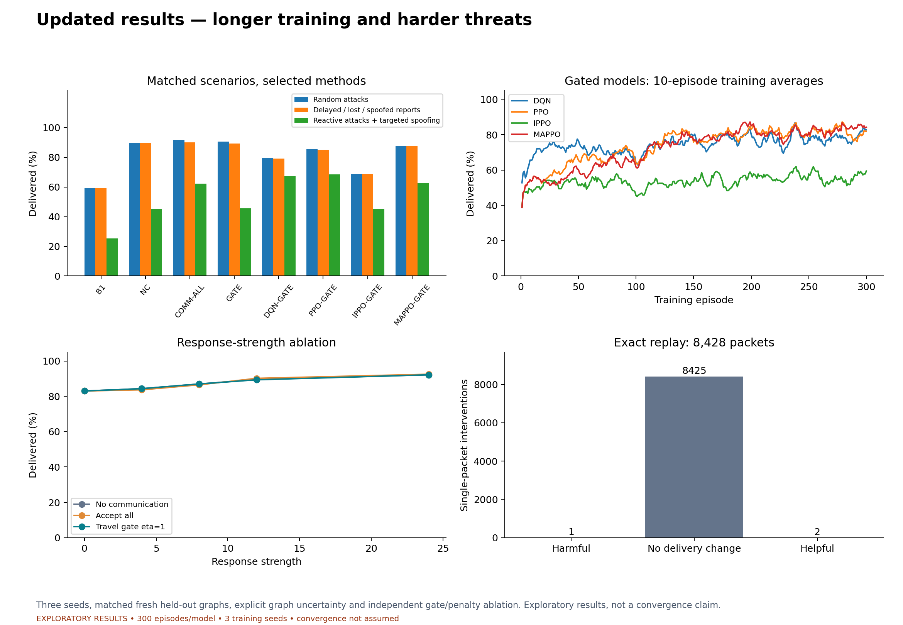
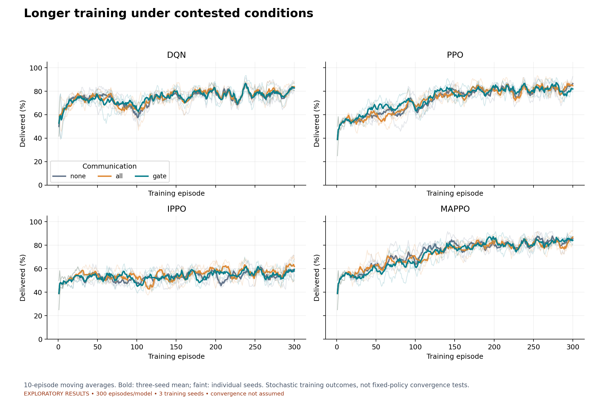
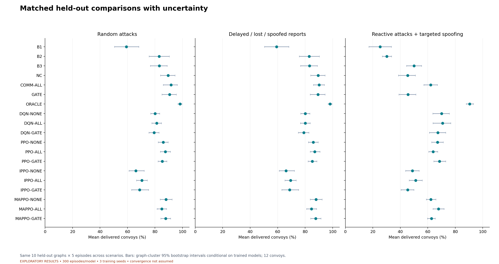
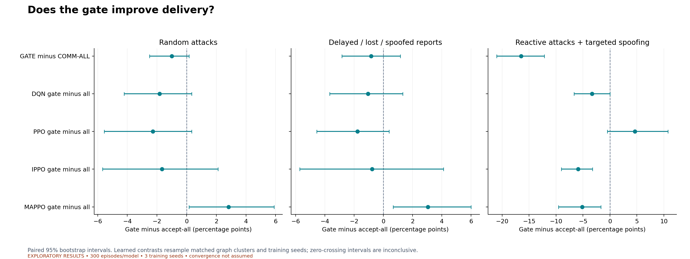
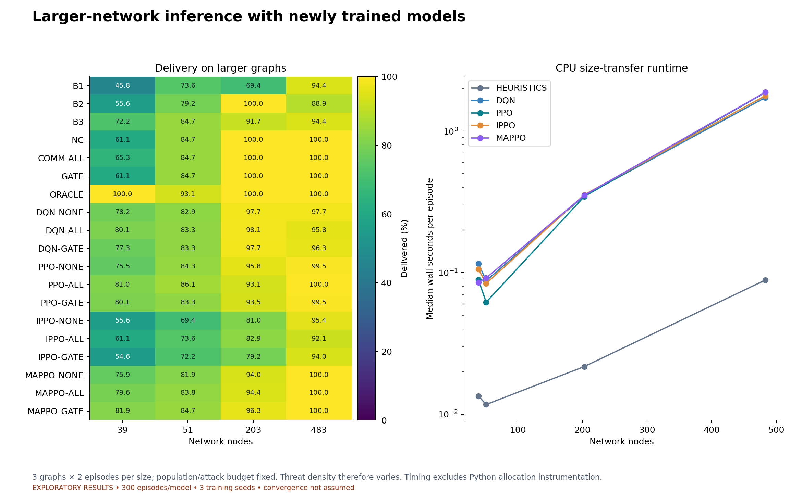
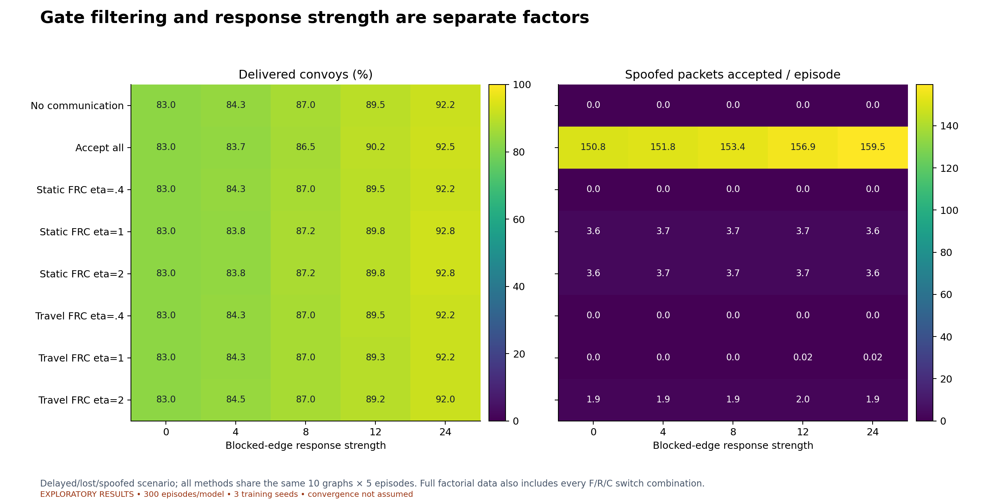
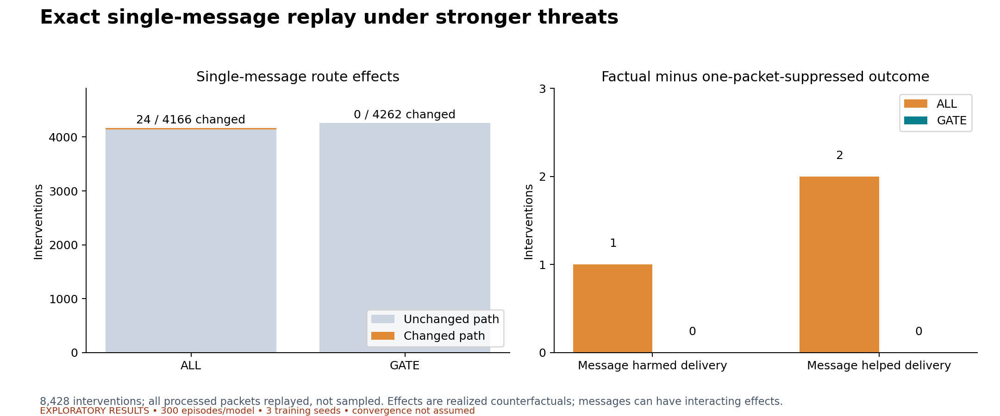
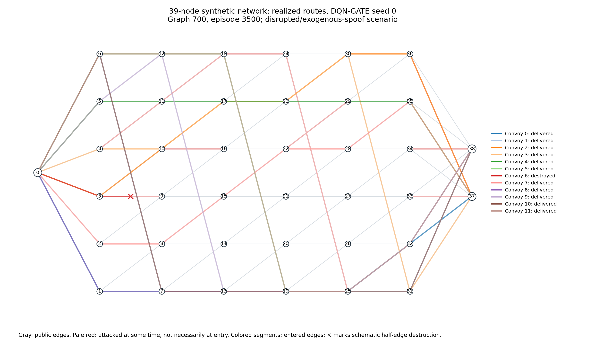
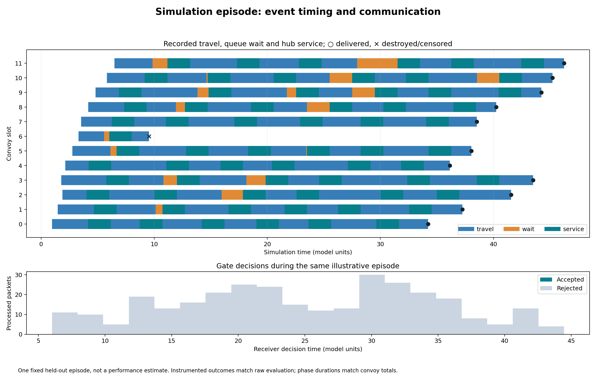

# Complete simulator: executed results

36 models; 300 episodes/model; 3 training seeds; 12 convoys/episode. Synthetic exploratory results. A fixed budget and smoothed training curves do not establish convergence.

Executed 10,800 training episodes, 6,450 held-out evaluation runs, 1,032 size-transfer runs, 12,500 ablations and 8,428 individual-message interventions.

## Delivery results

| method     |   Random (%) |   Disrupted/spoofed (%) |   Reactive/targeted (%) |
|:-----------|-------------:|------------------------:|------------------------:|
| B1         |        59.17 |                   59.17 |                   25.33 |
| B2         |        83.00 |                   83.00 |                   30.17 |
| B3         |        83.17 |                   83.17 |                   50.00 |
| COMM-ALL   |        91.67 |                   90.17 |                   62.17 |
| GATE       |        90.67 |                   89.33 |                   45.67 |
| NC         |        89.50 |                   89.50 |                   45.33 |
| ORACLE     |        98.17 |                   98.17 |                   90.50 |
| dqn-all    |        81.22 |                   80.11 |                   70.72 |
| dqn-gate   |        79.39 |                   79.06 |                   67.39 |
| dqn-none   |        80.11 |                   80.11 |                   70.06 |
| ippo-all   |        70.44 |                   69.44 |                   51.22 |
| ippo-gate  |        68.78 |                   68.67 |                   45.33 |
| ippo-none  |        66.11 |                   66.11 |                   48.83 |
| mappo-all  |        84.89 |                   84.61 |                   67.83 |
| mappo-gate |        87.72 |                   87.67 |                   62.67 |
| mappo-none |        88.00 |                   88.00 |                   62.22 |
| ppo-all    |        87.56 |                   87.00 |                   63.89 |
| ppo-gate   |        85.28 |                   85.22 |                   68.50 |
| ppo-none   |        85.94 |                   85.94 |                   67.06 |

## Single-message replay

| method   |   packets |   changed_paths |   helped_receiver |   harmed_receiver |   changed_episode_delivery |
|:---------|----------:|----------------:|------------------:|------------------:|---------------------------:|
| all      |      4166 |              24 |                 2 |                 1 |                          3 |
| gate     |      4262 |               0 |                 0 |                 0 |                          0 |

## Limitations and interpretation

Intervals are exploratory and not adjusted for multiple comparisons. Scenario delivery intervals resample graphs conditional on the fitted models. Learned gate-versus-all contrasts resample matched graphs and training seeds; only three training seeds are available. Reactive attack and targeted spoof traces respond to policy behavior. Controlled single-message replay uses random/exogenous threats and includes rejected packets. Scaling fixes population and attack budget, so threat density changes with graph size. The oracle is a diagnostic, not a proven optimal bound. Time is in arbitrary model units. Delivered-only cost/time averages have survivor conditioning and do not prove a per-convoy improvement. Military applicability is not established by synthetic networks.

Gate superiority is a hypothesis to test. Positive, negative and inconclusive differences are all retained in the report. The CSV files preserve full precision. Window diagnostics summarize training behavior; they are not a statistical convergence test.

## Read or download

[Combined seven-page vector PDF](updated_results_report.pdf).
[Two-page illustrative simulation PDF](simulation_episode_report.pdf).
[Self-contained HTML](index.html): download it and open it locally; no web server or Internet is needed.

## Figures

### Results overview



[Vector PDF](00_overview.pdf)

### Training curves



[Vector PDF](01_training.pdf)

### Held-out delivery and uncertainty



[Vector PDF](02_scenario_delivery.pdf)

### Paired gate-versus-all effects



[Vector PDF](03_gate_contrasts.pdf)

### Network-size transfer and CPU runtime



[Vector PDF](04_scaling.pdf)

### Filtering and response-strength ablation



[Vector PDF](05_ablation.pdf)

### Exact single-message replay



[Vector PDF](06_message_replay.pdf)

### Illustrative network and realized convoy routes



[Vector PDF](07_network_routes.pdf)

### Illustrative travel, queues, service and packet decisions



[Vector PDF](08_episode_timeline.pdf)

## Provenance

Held-out graph seeds: [700, 701, 702, 703, 704, 705, 706, 707, 708, 709]. Training graphs: 1–40. Complete parameters and commands are in the run manifests.

Source SHA-256: `596294a014a198d970957e41fc6bf55b92563518b0e73ac507159553cb50babd`.

From `simulator/`, validate and regenerate with fresh figure output:

```bash
python validate_results.py out/complete-model-v1
python plot_updated_results.py --run-root out/complete-model-v1 --output ../revision/regenerated-figures
python build_report.py --run-root out/complete-model-v1 --figures ../revision/regenerated-figures
```
