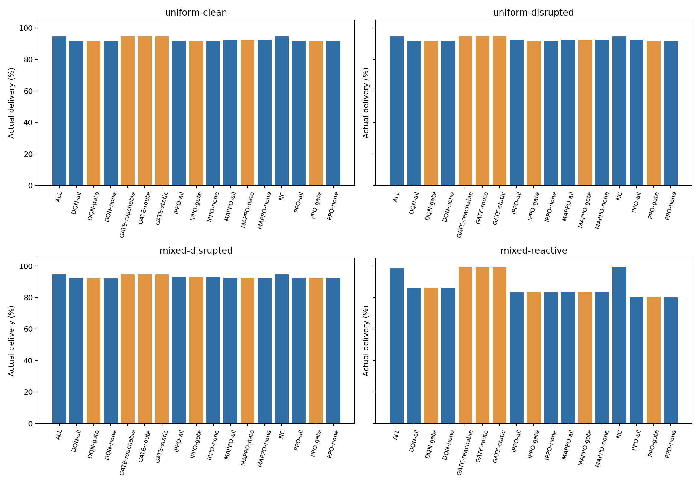
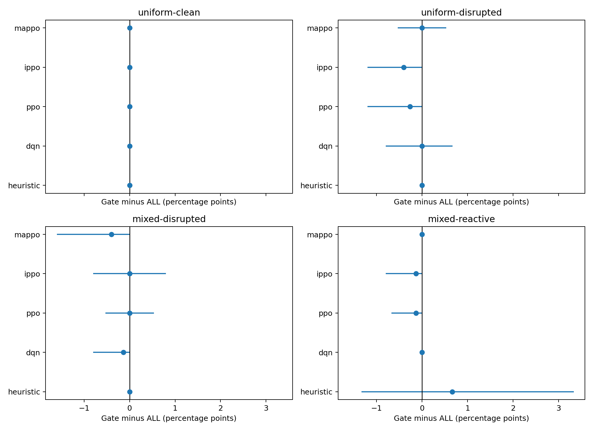
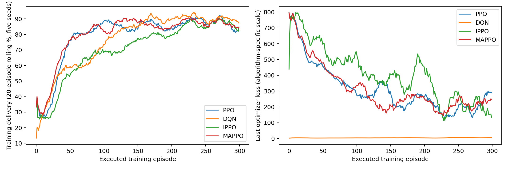
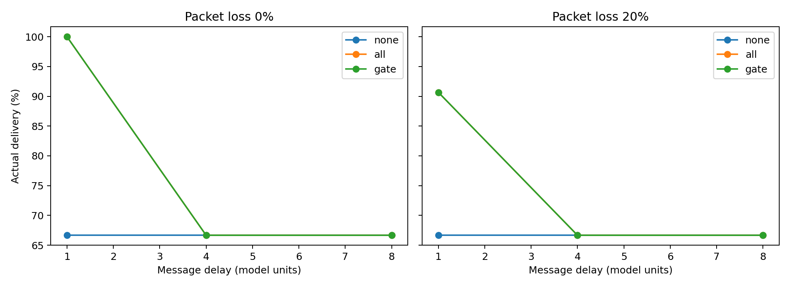
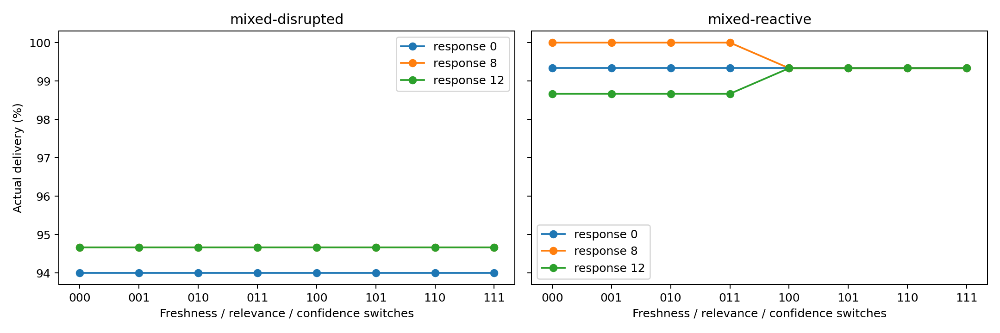
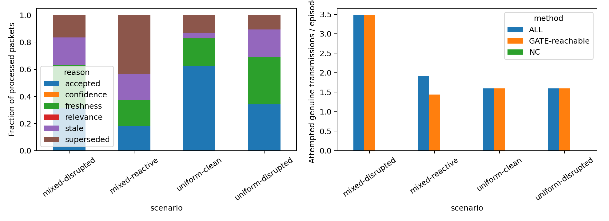
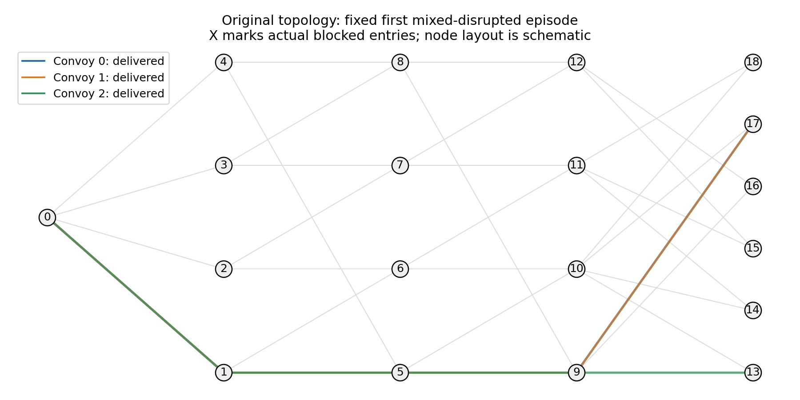
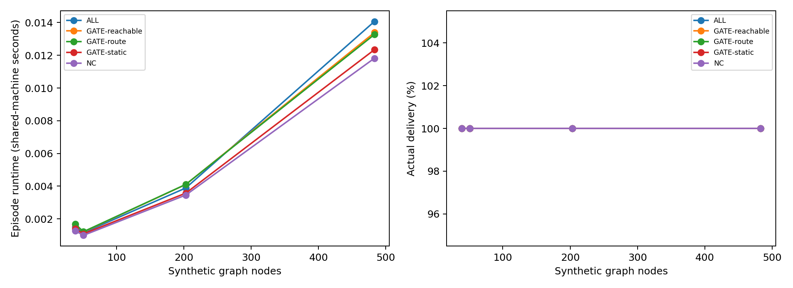
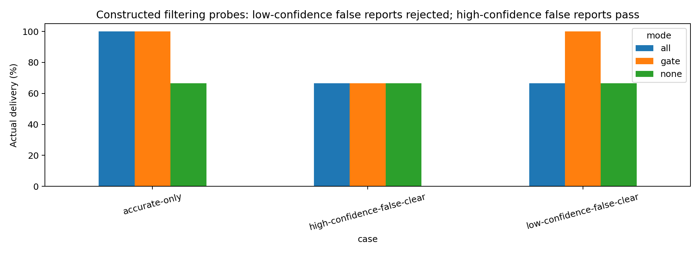

# Executed reviewer revision

Reviewer follow-up on the recovered original network. Twenty fresh models were trained with ALL communication and evaluated with frozen weights in none/all/gate modes. Five training seeds, 300 episodes per model, separate validation and 50 held-out schedules per scenario. This is a scientific diagnostic, not reproduction of submitted numbers or proof of general gate superiority.

| status   |   training_episodes |   models |   heldout_episodes |   convoy_records |   processed_messages |   cc2_episodes |   ablation_episodes |   m4_packet_interventions |   cc2_packet_interventions |   controlled_filtering_episodes |   controlled_packet_interventions |
|:---------|--------------------:|---------:|-------------------:|-----------------:|---------------------:|---------------:|--------------------:|--------------------------:|---------------------------:|--------------------------------:|----------------------------------:|
| passed   |                6000 |       20 |              13000 |            39000 |               124304 |            900 |                2400 |                       158 |                         40 |                             450 |                                80 |

## Held-out delivery

| scenario          | method         |   delivery |
|:------------------|:---------------|-----------:|
| mixed-disrupted   | ALL            |   0.946667 |
| mixed-disrupted   | DQN-all        |   0.922667 |
| mixed-disrupted   | DQN-gate       |   0.921333 |
| mixed-disrupted   | DQN-none       |   0.921333 |
| mixed-disrupted   | GATE-reachable |   0.946667 |
| mixed-disrupted   | GATE-route     |   0.946667 |
| mixed-disrupted   | GATE-static    |   0.946667 |
| mixed-disrupted   | IPPO-all       |   0.928    |
| mixed-disrupted   | IPPO-gate      |   0.928    |
| mixed-disrupted   | IPPO-none      |   0.928    |
| mixed-disrupted   | MAPPO-all      |   0.926667 |
| mixed-disrupted   | MAPPO-gate     |   0.922667 |
| mixed-disrupted   | MAPPO-none     |   0.922667 |
| mixed-disrupted   | NC             |   0.946667 |
| mixed-disrupted   | PPO-all        |   0.924    |
| mixed-disrupted   | PPO-gate       |   0.924    |
| mixed-disrupted   | PPO-none       |   0.924    |
| mixed-reactive    | ALL            |   0.986667 |
| mixed-reactive    | DQN-all        |   0.86     |
| mixed-reactive    | DQN-gate       |   0.86     |
| mixed-reactive    | DQN-none       |   0.86     |
| mixed-reactive    | GATE-reachable |   0.993333 |
| mixed-reactive    | GATE-route     |   0.993333 |
| mixed-reactive    | GATE-static    |   0.993333 |
| mixed-reactive    | IPPO-all       |   0.832    |
| mixed-reactive    | IPPO-gate      |   0.830667 |
| mixed-reactive    | IPPO-none      |   0.830667 |
| mixed-reactive    | MAPPO-all      |   0.833333 |
| mixed-reactive    | MAPPO-gate     |   0.833333 |
| mixed-reactive    | MAPPO-none     |   0.833333 |
| mixed-reactive    | NC             |   0.993333 |
| mixed-reactive    | PPO-all        |   0.802667 |
| mixed-reactive    | PPO-gate       |   0.801333 |
| mixed-reactive    | PPO-none       |   0.801333 |
| uniform-clean     | ALL            |   0.946667 |
| uniform-clean     | DQN-all        |   0.918667 |
| uniform-clean     | DQN-gate       |   0.918667 |
| uniform-clean     | DQN-none       |   0.918667 |
| uniform-clean     | GATE-reachable |   0.946667 |
| uniform-clean     | GATE-route     |   0.946667 |
| uniform-clean     | GATE-static    |   0.946667 |
| uniform-clean     | IPPO-all       |   0.918667 |
| uniform-clean     | IPPO-gate      |   0.918667 |
| uniform-clean     | IPPO-none      |   0.918667 |
| uniform-clean     | MAPPO-all      |   0.924    |
| uniform-clean     | MAPPO-gate     |   0.924    |
| uniform-clean     | MAPPO-none     |   0.924    |
| uniform-clean     | NC             |   0.946667 |
| uniform-clean     | PPO-all        |   0.92     |
| uniform-clean     | PPO-gate       |   0.92     |
| uniform-clean     | PPO-none       |   0.92     |
| uniform-disrupted | ALL            |   0.946667 |
| uniform-disrupted | DQN-all        |   0.918667 |
| uniform-disrupted | DQN-gate       |   0.918667 |
| uniform-disrupted | DQN-none       |   0.918667 |
| uniform-disrupted | GATE-reachable |   0.946667 |
| uniform-disrupted | GATE-route     |   0.946667 |
| uniform-disrupted | GATE-static    |   0.946667 |
| uniform-disrupted | IPPO-all       |   0.922667 |
| uniform-disrupted | IPPO-gate      |   0.918667 |
| uniform-disrupted | IPPO-none      |   0.918667 |
| uniform-disrupted | MAPPO-all      |   0.924    |
| uniform-disrupted | MAPPO-gate     |   0.924    |
| uniform-disrupted | MAPPO-none     |   0.924    |
| uniform-disrupted | NC             |   0.946667 |
| uniform-disrupted | PPO-all        |   0.922667 |
| uniform-disrupted | PPO-gate       |   0.92     |
| uniform-disrupted | PPO-none       |   0.92     |

## Gate contrasts

| scenario          | group     |   difference_pp |   lower_pp |   upper_pp | uncertainty                                                         |
|:------------------|:----------|----------------:|-----------:|-----------:|:--------------------------------------------------------------------|
| uniform-clean     | heuristic |     0           |   0        |   0        | paired episode and training-seed bootstrap; fixed original topology |
| uniform-clean     | dqn       |     0           |   0        |   0        | paired episode and training-seed bootstrap; fixed original topology |
| uniform-clean     | ppo       |     0           |   0        |   0        | paired episode and training-seed bootstrap; fixed original topology |
| uniform-clean     | ippo      |     0           |   0        |   0        | paired episode and training-seed bootstrap; fixed original topology |
| uniform-clean     | mappo     |     0           |   0        |   0        | paired episode and training-seed bootstrap; fixed original topology |
| uniform-disrupted | heuristic |     0           |   0        |   0        | paired episode and training-seed bootstrap; fixed original topology |
| uniform-disrupted | dqn       |    -2.22045e-17 |  -0.8      |   0.67     | paired episode and training-seed bootstrap; fixed original topology |
| uniform-disrupted | ppo       |    -0.266667    |  -1.2      |   0        | paired episode and training-seed bootstrap; fixed original topology |
| uniform-disrupted | ippo      |    -0.4         |  -1.2      |   0        | paired episode and training-seed bootstrap; fixed original topology |
| uniform-disrupted | mappo     |    -2.22045e-17 |  -0.533333 |   0.533333 | paired episode and training-seed bootstrap; fixed original topology |
| mixed-disrupted   | heuristic |     0           |   0        |   0        | paired episode and training-seed bootstrap; fixed original topology |
| mixed-disrupted   | dqn       |    -0.133333    |  -0.8      |   0        | paired episode and training-seed bootstrap; fixed original topology |
| mixed-disrupted   | ppo       |    -2.22045e-17 |  -0.533333 |   0.533333 | paired episode and training-seed bootstrap; fixed original topology |
| mixed-disrupted   | ippo      |    -2.22045e-17 |  -0.8      |   0.8      | paired episode and training-seed bootstrap; fixed original topology |
| mixed-disrupted   | mappo     |    -0.4         |  -1.6      |   0        | paired episode and training-seed bootstrap; fixed original topology |
| mixed-reactive    | heuristic |     0.666667    |  -1.33333  |   3.33333  | paired episode and training-seed bootstrap; fixed original topology |
| mixed-reactive    | dqn       |     0           |   0        |   0        | paired episode and training-seed bootstrap; fixed original topology |
| mixed-reactive    | ppo       |    -0.133333    |  -0.67     |   0        | paired episode and training-seed bootstrap; fixed original topology |
| mixed-reactive    | ippo      |    -0.133333    |  -0.8      |   0        | paired episode and training-seed bootstrap; fixed original topology |
| mixed-reactive    | mappo     |     0           |   0        |   0        | paired episode and training-seed bootstrap; fixed original topology |

## Controlled filtering probes

| case                        | mode   |   delivery_rate |
|:----------------------------|:-------|----------------:|
| accurate-only               | all    |        1        |
| accurate-only               | gate   |        1        |
| accurate-only               | none   |        0.666667 |
| high-confidence-false-clear | all    |        0.666667 |
| high-confidence-false-clear | gate   |        0.666667 |
| high-confidence-false-clear | none   |        0.666667 |
| low-confidence-false-clear  | all    |        0.666667 |
| low-confidence-false-clear  | gate   |        1        |
| low-confidence-false-clear  | none   |        0.666667 |

These deliberately constructed cases demonstrate a filtering benefit for low-confidence false clear reports and failure against high-confidence false clear reports. They do not establish general superiority.

One original topology; fixed-weight inference contrasts; gate thresholds selected on heuristic validation; no convergence proof or full algorithm-specific hyperparameter tuning. CC2 is an explicit sensing-asymmetry fixture with actual binary attacks. Scaling is heuristic inference only. Communication counts distinguish transmissions from admission. Original manuscript values and generated curves are excluded.

## Held-out delivery: original topology

## Paired uncertainty: episodes and training seeds on fixed topology

## Executed training diagnostics; no convergence guarantee

## Controlled scout/follower fixture: actual interdiction and declared blind corridors

## Filtering versus response strength; zero-strength invariance checked

## Admission is not bandwidth reduction; routing can change later transmissions

## Illustrative routes checked against raw held-out records

## Descriptive heuristic scaling, two schedules; fixed convoy population and attack budget

## Filtering benefit and failure boundary, fixed confidence threshold 0.6

