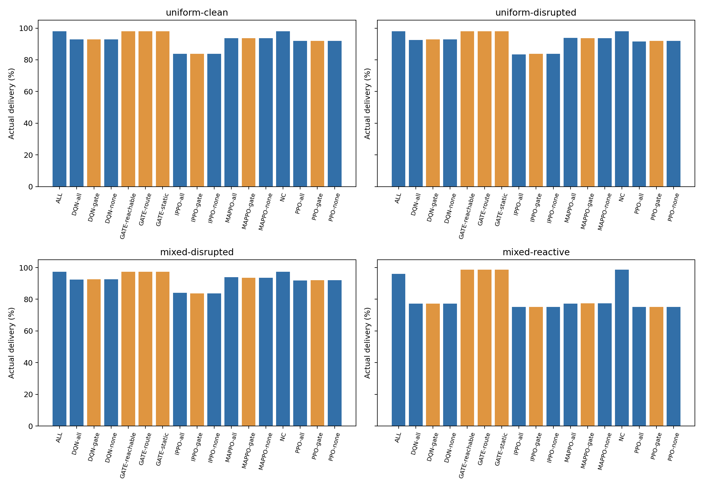
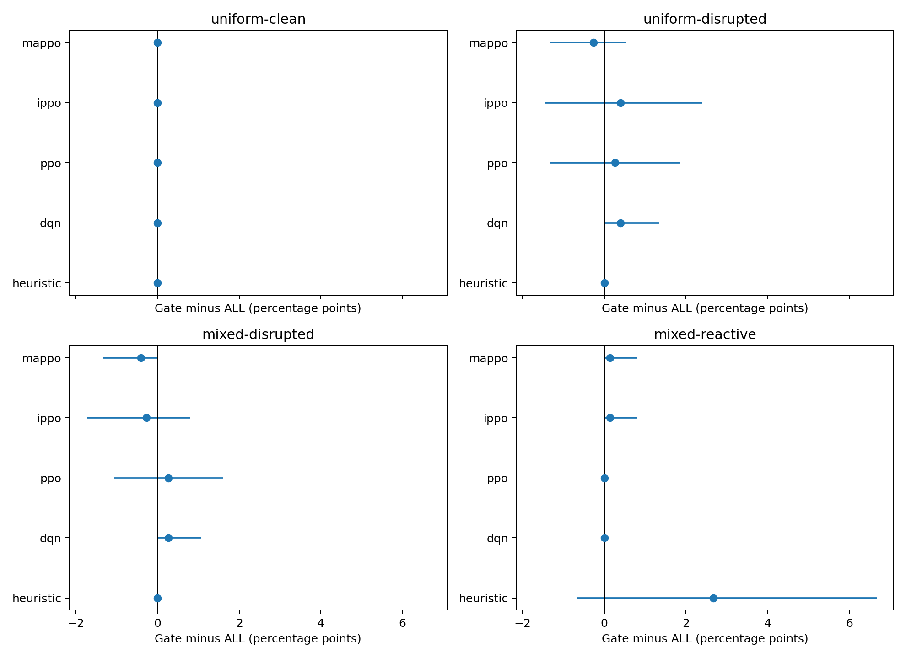
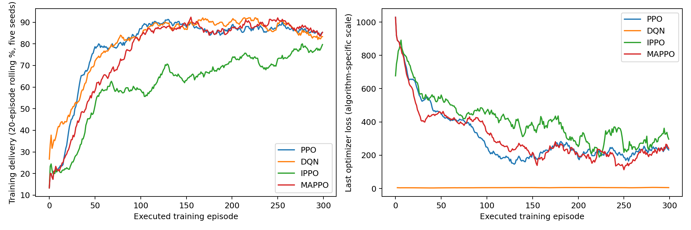
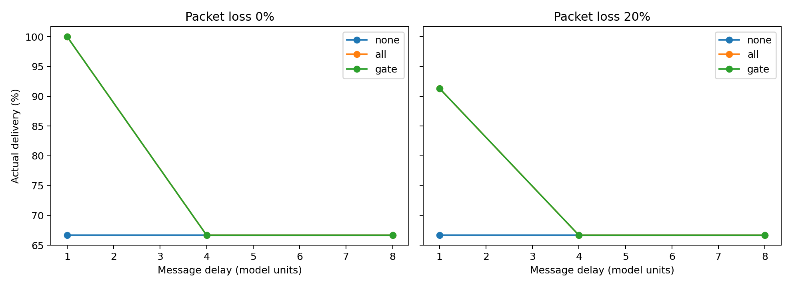
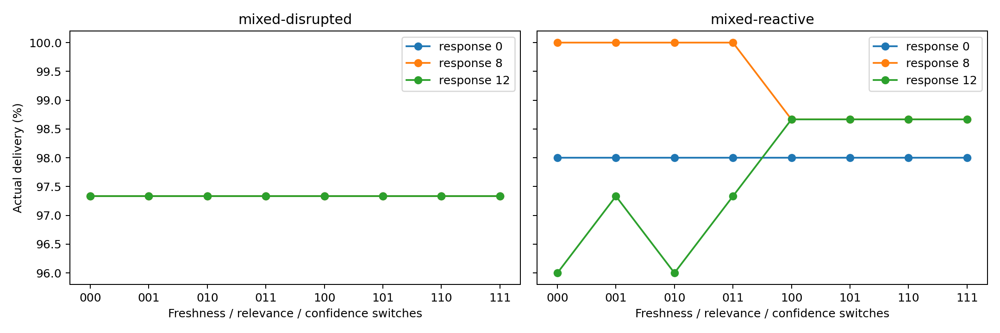
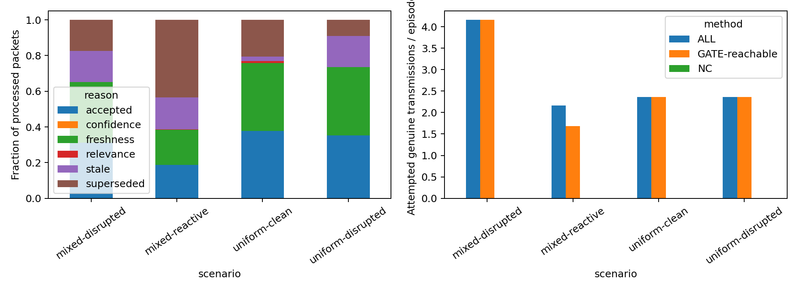
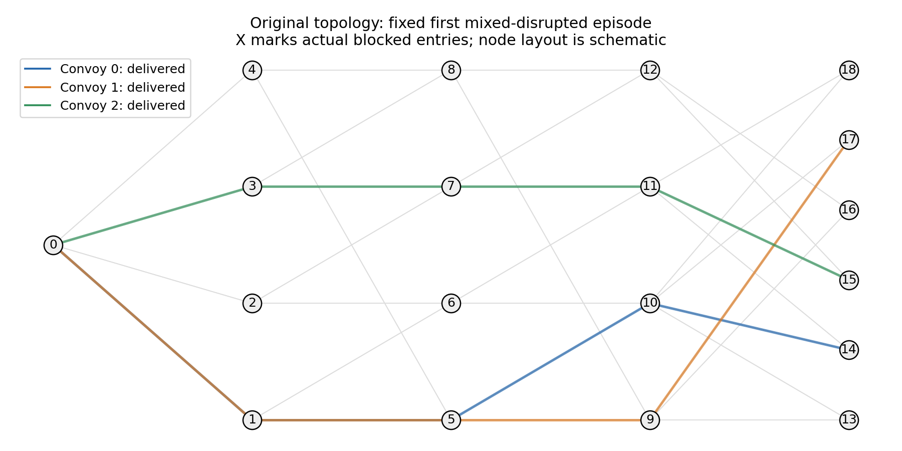
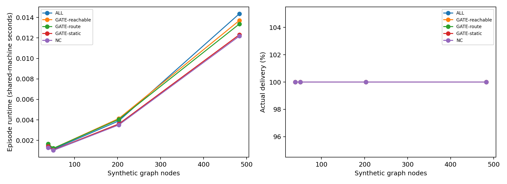

# Executed reviewer revision

Reviewer follow-up on the recovered original network. Twenty fresh models were trained with ALL communication and evaluated with frozen weights in none/all/gate modes. Five training seeds, 300 episodes per model, separate validation and 50 held-out schedules per scenario. This is a scientific diagnostic, not reproduction of submitted numbers or proof of general gate superiority.

| status   |   training_episodes |   models |   heldout_episodes |   convoy_records |   processed_messages |   cc2_episodes |   ablation_episodes |   m4_packet_interventions |   cc2_packet_interventions |
|:---------|--------------------:|---------:|-------------------:|-----------------:|---------------------:|---------------:|--------------------:|--------------------------:|---------------------------:|
| passed   |                6000 |       20 |              13000 |            39000 |               124674 |            900 |                2400 |                       136 |                         40 |

## Held-out delivery

| scenario          | method         |   delivery |
|:------------------|:---------------|-----------:|
| mixed-disrupted   | ALL            |   0.973333 |
| mixed-disrupted   | DQN-all        |   0.924    |
| mixed-disrupted   | DQN-gate       |   0.926667 |
| mixed-disrupted   | DQN-none       |   0.926667 |
| mixed-disrupted   | GATE-reachable |   0.973333 |
| mixed-disrupted   | GATE-route     |   0.973333 |
| mixed-disrupted   | GATE-static    |   0.973333 |
| mixed-disrupted   | IPPO-all       |   0.84     |
| mixed-disrupted   | IPPO-gate      |   0.837333 |
| mixed-disrupted   | IPPO-none      |   0.837333 |
| mixed-disrupted   | MAPPO-all      |   0.938667 |
| mixed-disrupted   | MAPPO-gate     |   0.934667 |
| mixed-disrupted   | MAPPO-none     |   0.934667 |
| mixed-disrupted   | NC             |   0.973333 |
| mixed-disrupted   | PPO-all        |   0.918667 |
| mixed-disrupted   | PPO-gate       |   0.921333 |
| mixed-disrupted   | PPO-none       |   0.921333 |
| mixed-reactive    | ALL            |   0.96     |
| mixed-reactive    | DQN-all        |   0.772    |
| mixed-reactive    | DQN-gate       |   0.772    |
| mixed-reactive    | DQN-none       |   0.772    |
| mixed-reactive    | GATE-reachable |   0.986667 |
| mixed-reactive    | GATE-route     |   0.986667 |
| mixed-reactive    | GATE-static    |   0.986667 |
| mixed-reactive    | IPPO-all       |   0.750667 |
| mixed-reactive    | IPPO-gate      |   0.752    |
| mixed-reactive    | IPPO-none      |   0.752    |
| mixed-reactive    | MAPPO-all      |   0.773333 |
| mixed-reactive    | MAPPO-gate     |   0.774667 |
| mixed-reactive    | MAPPO-none     |   0.774667 |
| mixed-reactive    | NC             |   0.986667 |
| mixed-reactive    | PPO-all        |   0.752    |
| mixed-reactive    | PPO-gate       |   0.752    |
| mixed-reactive    | PPO-none       |   0.752    |
| uniform-clean     | ALL            |   0.98     |
| uniform-clean     | DQN-all        |   0.929333 |
| uniform-clean     | DQN-gate       |   0.929333 |
| uniform-clean     | DQN-none       |   0.929333 |
| uniform-clean     | GATE-reachable |   0.98     |
| uniform-clean     | GATE-route     |   0.98     |
| uniform-clean     | GATE-static    |   0.98     |
| uniform-clean     | IPPO-all       |   0.838667 |
| uniform-clean     | IPPO-gate      |   0.838667 |
| uniform-clean     | IPPO-none      |   0.838667 |
| uniform-clean     | MAPPO-all      |   0.936    |
| uniform-clean     | MAPPO-gate     |   0.936    |
| uniform-clean     | MAPPO-none     |   0.936    |
| uniform-clean     | NC             |   0.98     |
| uniform-clean     | PPO-all        |   0.918667 |
| uniform-clean     | PPO-gate       |   0.918667 |
| uniform-clean     | PPO-none       |   0.918667 |
| uniform-disrupted | ALL            |   0.98     |
| uniform-disrupted | DQN-all        |   0.925333 |
| uniform-disrupted | DQN-gate       |   0.929333 |
| uniform-disrupted | DQN-none       |   0.929333 |
| uniform-disrupted | GATE-reachable |   0.98     |
| uniform-disrupted | GATE-route     |   0.98     |
| uniform-disrupted | GATE-static    |   0.98     |
| uniform-disrupted | IPPO-all       |   0.834667 |
| uniform-disrupted | IPPO-gate      |   0.838667 |
| uniform-disrupted | IPPO-none      |   0.838667 |
| uniform-disrupted | MAPPO-all      |   0.938667 |
| uniform-disrupted | MAPPO-gate     |   0.936    |
| uniform-disrupted | MAPPO-none     |   0.936    |
| uniform-disrupted | NC             |   0.98     |
| uniform-disrupted | PPO-all        |   0.916    |
| uniform-disrupted | PPO-gate       |   0.918667 |
| uniform-disrupted | PPO-none       |   0.918667 |

## Gate contrasts

| scenario          | group     |   difference_pp |   lower_pp |   upper_pp | uncertainty                                                         |
|:------------------|:----------|----------------:|-----------:|-----------:|:--------------------------------------------------------------------|
| uniform-clean     | heuristic |        0        |   0        |   0        | paired episode and training-seed bootstrap; fixed original topology |
| uniform-clean     | dqn       |        0        |   0        |   0        | paired episode and training-seed bootstrap; fixed original topology |
| uniform-clean     | ppo       |        0        |   0        |   0        | paired episode and training-seed bootstrap; fixed original topology |
| uniform-clean     | ippo      |        0        |   0        |   0        | paired episode and training-seed bootstrap; fixed original topology |
| uniform-clean     | mappo     |        0        |   0        |   0        | paired episode and training-seed bootstrap; fixed original topology |
| uniform-disrupted | heuristic |        0        |   0        |   0        | paired episode and training-seed bootstrap; fixed original topology |
| uniform-disrupted | dqn       |        0.4      |   0        |   1.33333  | paired episode and training-seed bootstrap; fixed original topology |
| uniform-disrupted | ppo       |        0.266667 |  -1.33333  |   1.86667  | paired episode and training-seed bootstrap; fixed original topology |
| uniform-disrupted | ippo      |        0.4      |  -1.46667  |   2.4      | paired episode and training-seed bootstrap; fixed original topology |
| uniform-disrupted | mappo     |       -0.266667 |  -1.33333  |   0.533333 | paired episode and training-seed bootstrap; fixed original topology |
| mixed-disrupted   | heuristic |        0        |   0        |   0        | paired episode and training-seed bootstrap; fixed original topology |
| mixed-disrupted   | dqn       |        0.266667 |   0        |   1.06667  | paired episode and training-seed bootstrap; fixed original topology |
| mixed-disrupted   | ppo       |        0.266667 |  -1.06667  |   1.6      | paired episode and training-seed bootstrap; fixed original topology |
| mixed-disrupted   | ippo      |       -0.266667 |  -1.73333  |   0.8      | paired episode and training-seed bootstrap; fixed original topology |
| mixed-disrupted   | mappo     |       -0.4      |  -1.33333  |   0        | paired episode and training-seed bootstrap; fixed original topology |
| mixed-reactive    | heuristic |        2.66667  |  -0.666667 |   6.66667  | paired episode and training-seed bootstrap; fixed original topology |
| mixed-reactive    | dqn       |        0        |   0        |   0        | paired episode and training-seed bootstrap; fixed original topology |
| mixed-reactive    | ppo       |        0        |   0        |   0        | paired episode and training-seed bootstrap; fixed original topology |
| mixed-reactive    | ippo      |        0.133333 |   0        |   0.8      | paired episode and training-seed bootstrap; fixed original topology |
| mixed-reactive    | mappo     |        0.133333 |   0        |   0.8      | paired episode and training-seed bootstrap; fixed original topology |

One original topology; fixed-weight inference contrasts; gate thresholds selected on heuristic validation; no convergence proof or full algorithm-specific hyperparameter tuning. CC2 is an explicit sensing-asymmetry fixture with actual binary attacks. Scaling is heuristic inference only. Communication counts distinguish transmissions from admission. Original manuscript values and generated curves are excluded.

## Held-out delivery: original topology

## Paired uncertainty: episodes and training seeds on fixed topology

## Executed training diagnostics; no convergence guarantee

## Controlled scout/follower fixture: actual interdiction and declared blind corridors

## Filtering versus response strength; zero-strength invariance checked

## Admission is not bandwidth reduction; routing can change later transmissions

## Illustrative routes checked against raw held-out records

## Descriptive heuristic scaling, two schedules; fixed convoy population and attack budget

