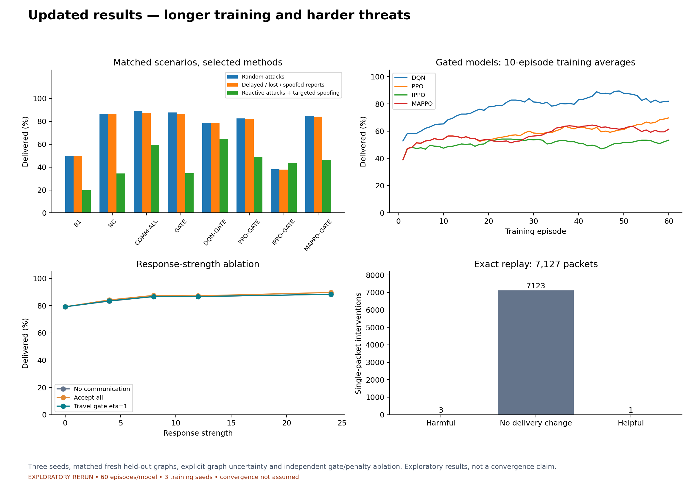
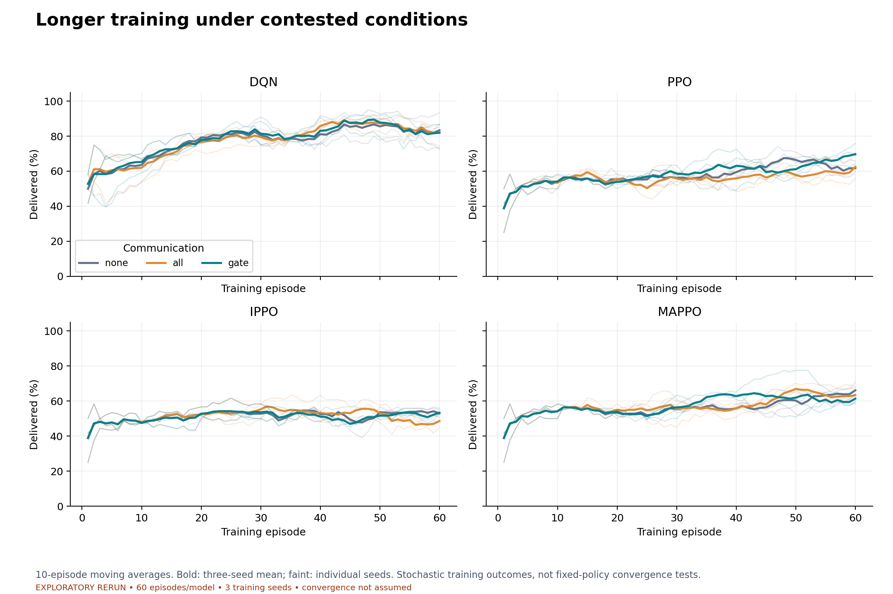
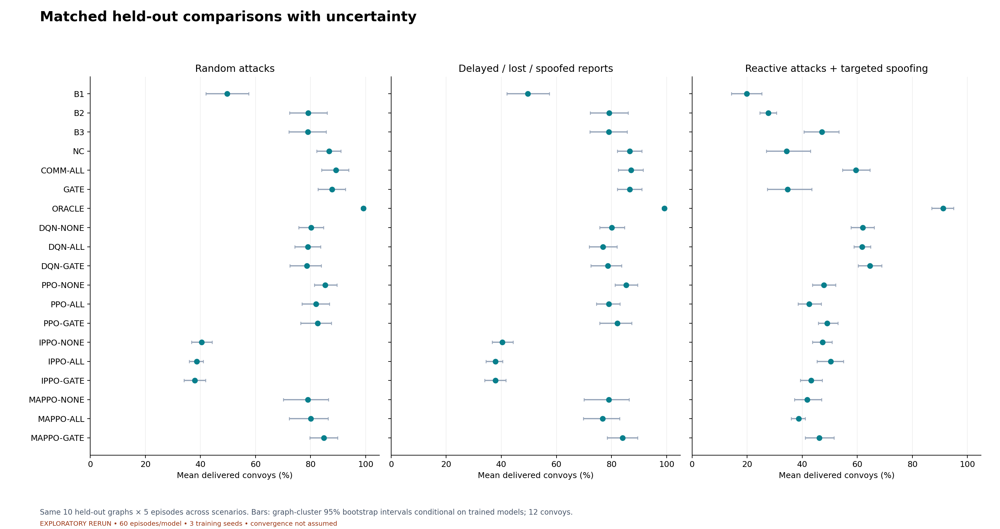
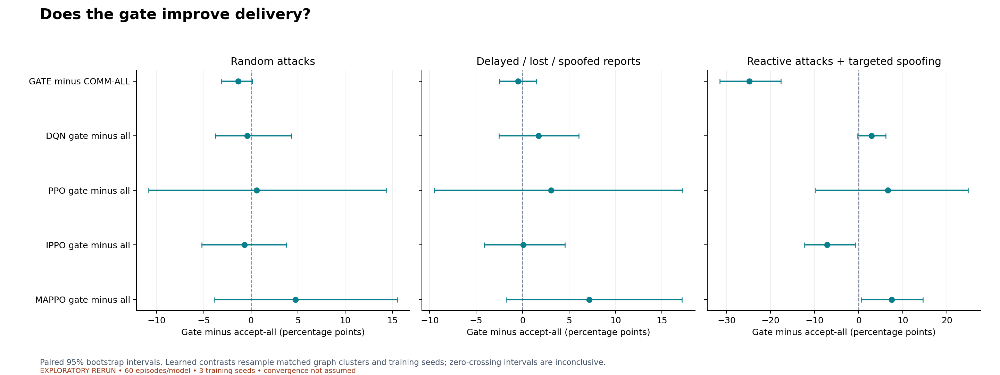
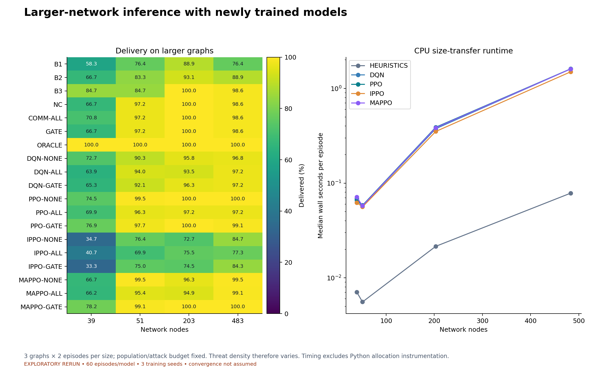
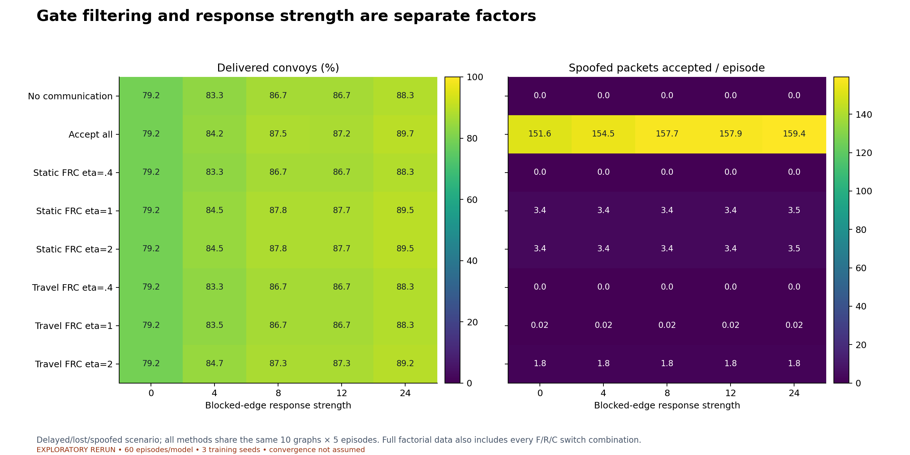
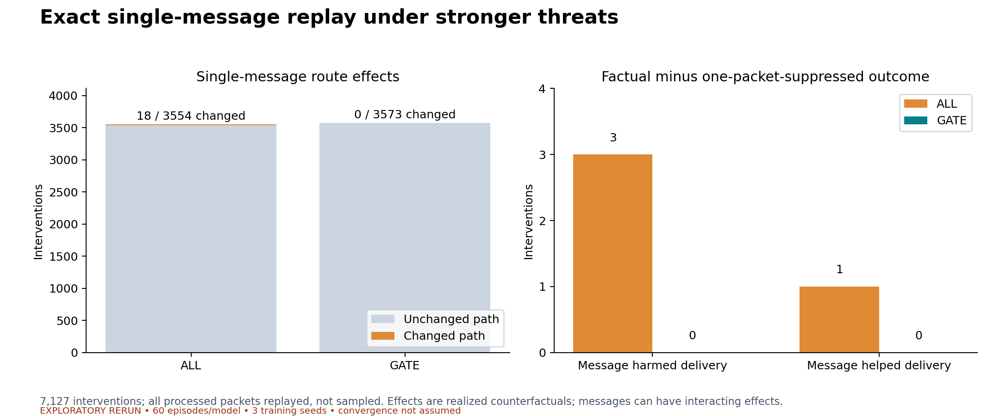

# Updated exploratory results

EXPLORATORY RERUN • 60 episodes/model • 3 training seeds • convergence not assumed

All reported figures are regenerated from the rerun data, not the old smoke results.

The paired comparison intervals are exploratory and are not adjusted for multiple comparisons. Three training seeds do not establish robust retraining uncertainty. The oracle is a true-state diagnostic, not an optimal performance bound. Larger networks retain the same population and attack budget, so threat density changes.

[Combined PDF report](updated_results_report.pdf)

## Updated results — longer training and harder threats

[Vector PDF](00_overview.pdf)

## Longer training under contested conditions

[Vector PDF](01_training.pdf)

## Matched held-out comparisons with uncertainty

[Vector PDF](02_scenario_delivery.pdf)

## Does the gate improve delivery?

[Vector PDF](03_gate_contrasts.pdf)

## Larger-network inference with newly trained models

[Vector PDF](04_scaling.pdf)

## Gate filtering and response strength are separate factors

[Vector PDF](05_ablation.pdf)

## Exact single-message replay under stronger threats

[Vector PDF](06_message_replay.pdf)
