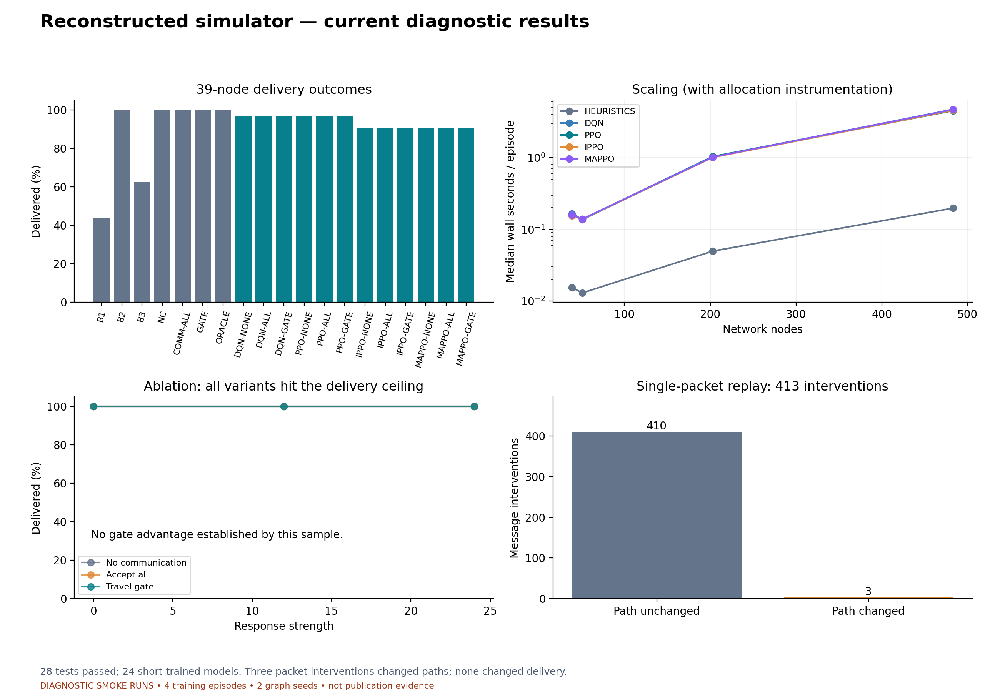
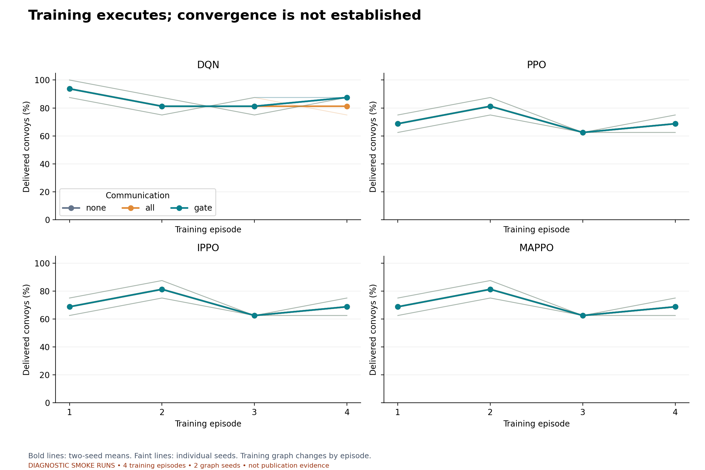
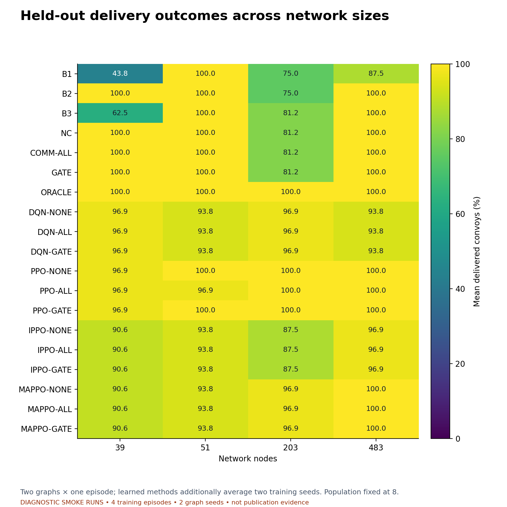
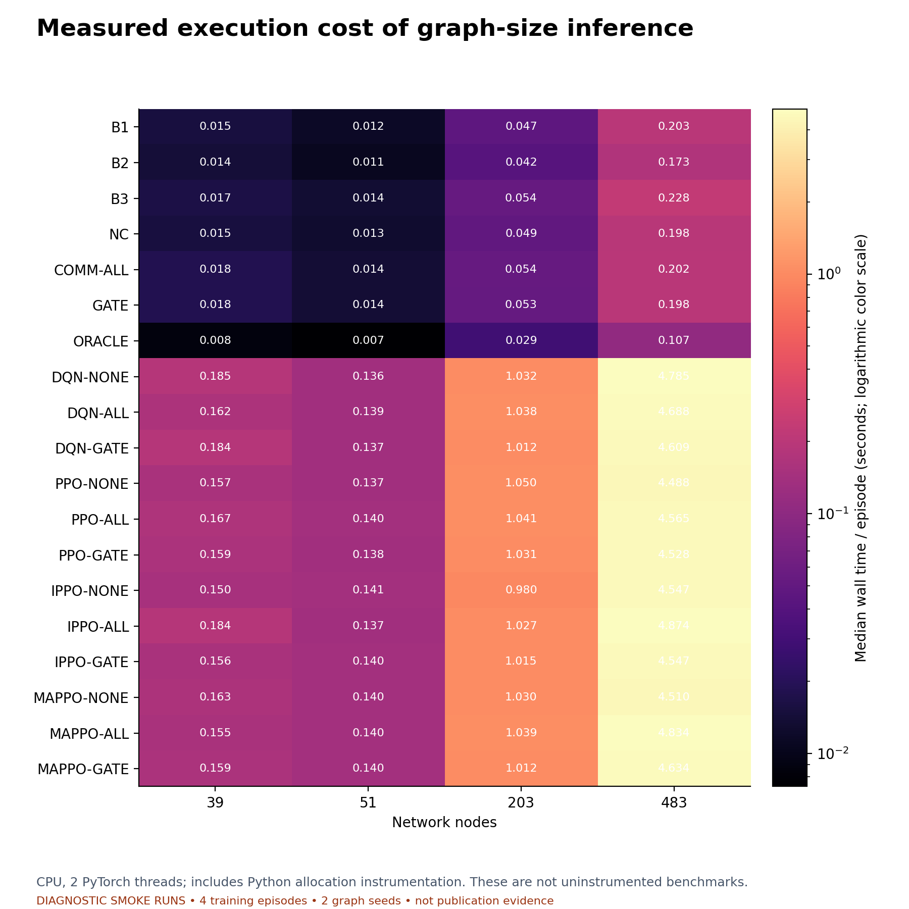
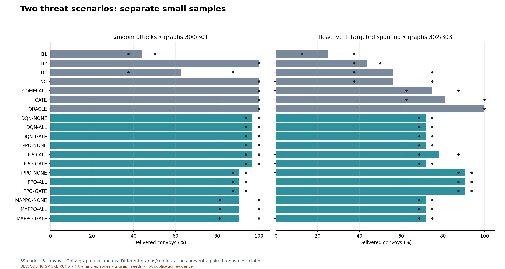
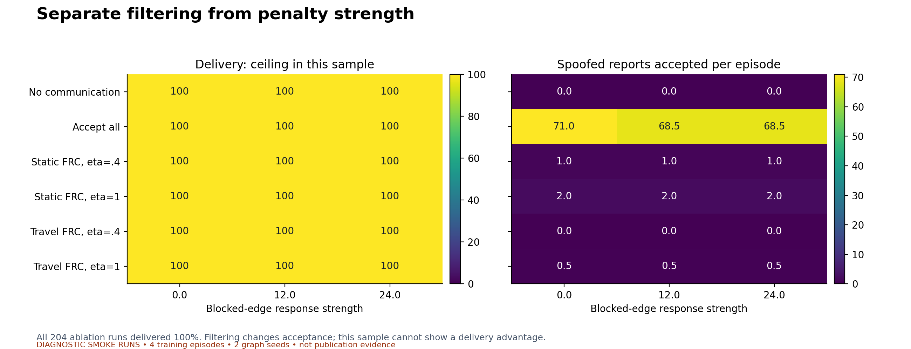
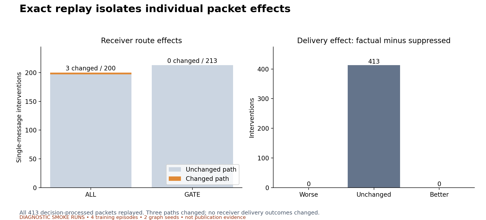

# Current results visualisations

DIAGNOSTIC SMOKE RUNS • 4 training episodes • 2 graph seeds • not publication evidence

Simulator reconstruction and functional validation are complete. Full convergence training, adequately replicated experiments and revised manuscript tables are still pending.

[Download the seven-page PDF report](results_report.pdf)

## Reconstructed simulator — current diagnostic results

A compact summary of execution checks and present limitations.

[Vector PDF](00_overview.pdf)

## Training executes; convergence is not established

Only four episodes per model: these curves do not establish convergence.

[Vector PDF](01_training.pdf)

## Held-out delivery outcomes across network sizes

Held-out outcomes averaged within each method; only two graph seeds.

[Vector PDF](02_delivery_by_size.pdf)

## Measured execution cost of graph-size inference

Instrumentation is included; use these timings as diagnostic scaling measurements.

[Vector PDF](03_runtime_by_size.pdf)

## Two threat scenarios: separate small samples

Separate scenarios use different graph seeds, so differences are not a controlled threat effect.

[Vector PDF](04_threat_scenarios.pdf)

## Separate filtering from penalty strength

Every ablation delivered 100%; reduced spoof acceptance is not proof of improved delivery.

[Vector PDF](05_filter_and_penalty.pdf)

## Exact replay isolates individual packet effects

413 full-message interventions; three changed paths and none changed delivery.

[Vector PDF](06_message_counterfactuals.pdf)
