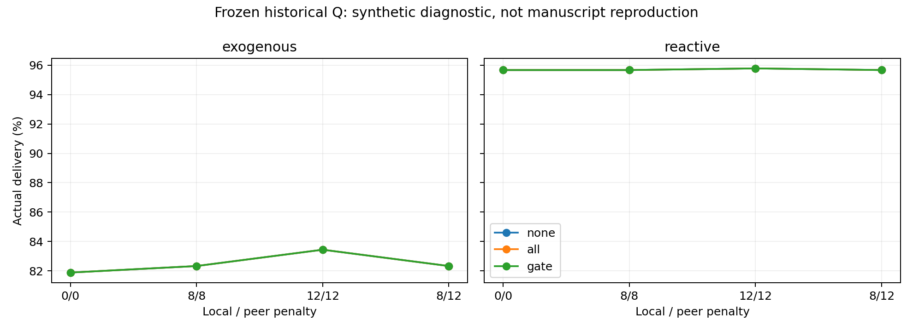

# Manuscript gate diagnosis

This synthetic mechanism experiment does not reproduce submitted numbers. See manifest.json for assumptions and checks. Models are trained locally then frozen for all communication comparisons. Graphs have 17 nodes, with fixed target and simultaneous departures. Actual delivery is distinct from the manuscript route-survival proxy. Penalty labels are local/peer strengths. Intervals resample graph and training seed; with only three graphs these are diagnostic. Receiving/filtering messages does not itself reduce transmitted bandwidth.

| scenario   | penalties   | comparison      |   difference_pp |   lower_pp |   upper_pp |
|:-----------|:------------|:----------------|----------------:|-----------:|-----------:|
| exogenous  | 0/0         | gate minus all  |               0 |          0 |          0 |
| exogenous  | 0/0         | gate minus none |               0 |          0 |          0 |
| exogenous  | 8/8         | gate minus all  |               0 |          0 |          0 |
| exogenous  | 8/8         | gate minus none |               0 |          0 |          0 |
| exogenous  | 12/12       | gate minus all  |               0 |          0 |          0 |
| exogenous  | 12/12       | gate minus none |               0 |          0 |          0 |
| exogenous  | 8/12        | gate minus all  |               0 |          0 |          0 |
| exogenous  | 8/12        | gate minus none |               0 |          0 |          0 |
| reactive   | 0/0         | gate minus all  |               0 |          0 |          0 |
| reactive   | 0/0         | gate minus none |               0 |          0 |          0 |
| reactive   | 8/8         | gate minus all  |               0 |          0 |          0 |
| reactive   | 8/8         | gate minus none |               0 |          0 |          0 |
| reactive   | 12/12       | gate minus all  |               0 |          0 |          0 |
| reactive   | 12/12       | gate minus none |               0 |          0 |          0 |
| reactive   | 8/12        | gate minus all  |               0 |          0 |          0 |
| reactive   | 8/12        | gate minus none |               0 |          0 |          0 |
